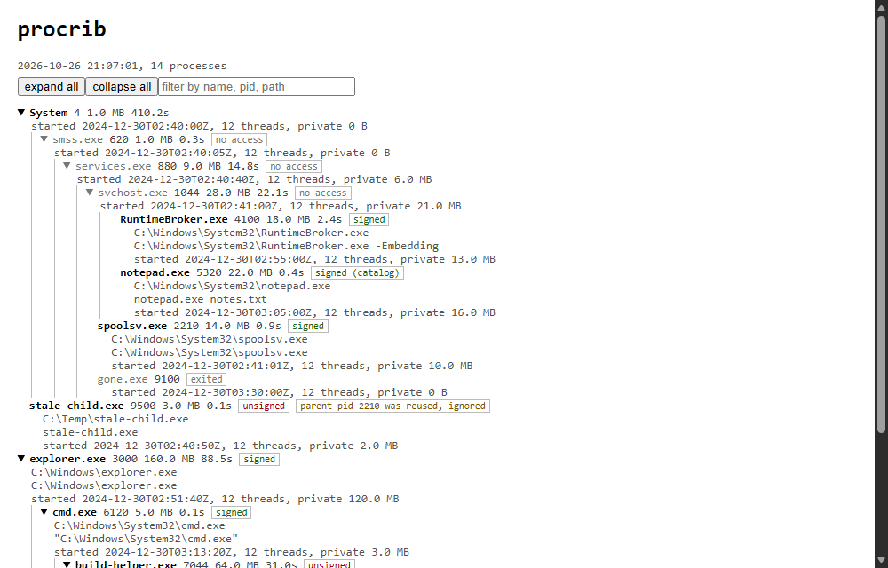

# procrib

A read-only process tree viewer for Windows, written in C++17. It prints a colored tree in the console, and can export the same tree as a collapsible HTML page or as JSON.

For each process it shows PID, working set, CPU time (or CPU % in watch mode), image path, command line, and optionally the signature status. The list comes from `NtQuerySystemInformation`; paths and command lines come from `OpenProcess` with query-limited rights plus `NtQueryInformationProcess`. It never opens a process with anything that can write, and it has no kill or inject paths.

## Build

    cmake -S . -B build
    cmake --build build
    ctest --test-dir build --output-on-failure

Tested here with MinGW g++ 14 (`-G "MinGW Makefiles"`). The workflow in `.github/workflows` builds with the default Visual Studio generator on `windows-latest`; I have not seen that run yet.

## Usage

    procrib                      console tree
    procrib -v                   also path and command line per process
    procrib --sig                check signatures (slower, see below)
    procrib --watch 2            redraw every 2 s, shows CPU %
    procrib --html tree.html     self-contained HTML, expand/collapse and a filter box
    procrib --json > tree.json   nested JSON
    procrib --demo --html d.html built-in fake list, no real process data

`docs/demo.html` is the page that screenshot was taken from.

## How the tree is built

Each process records its parent's PID, and Windows reuses PIDs. A process whose recorded parent started after it cannot really be its child, so it is shown as a root with a note instead of being hung under an unrelated process. A parent that is no longer running is marked as an orphan, and a parent loop (only possible when start times are missing) is cut at the oldest process. System (PID 4) is exempt from the start-time check because kernel-created processes like Registry predate its timestamp. The logic is in `src/proctree.cpp` and is the part covered by the tests, which use fake process lists.

Processes that cannot be opened show `[no access]` and still appear in the tree, since the process list itself includes the PID, parent, start time, threads and memory. Processes that exit between the list and the open show `exited`.

## Limits
- Run non-elevated, most services show no path or command line. Running as administrator helps but protected processes still refuse.
- Signature check uses `WinVerifyTrust` on the file, falling back to the catalog database, with no revocation checking. It checks the file on disk, not the mapped image, so it says nothing about tampering in memory. Results are cached per path within one run.
- CPU % is averaged across all logical processors and only appears from the second refresh in `--watch`.
- Names and paths are shown as UTF-8; a console font without the glyphs will show boxes.
- x64 Windows 10/11 only; `ProcessCommandLineInformation` needs 8.1 or later.

MIT licensed.
